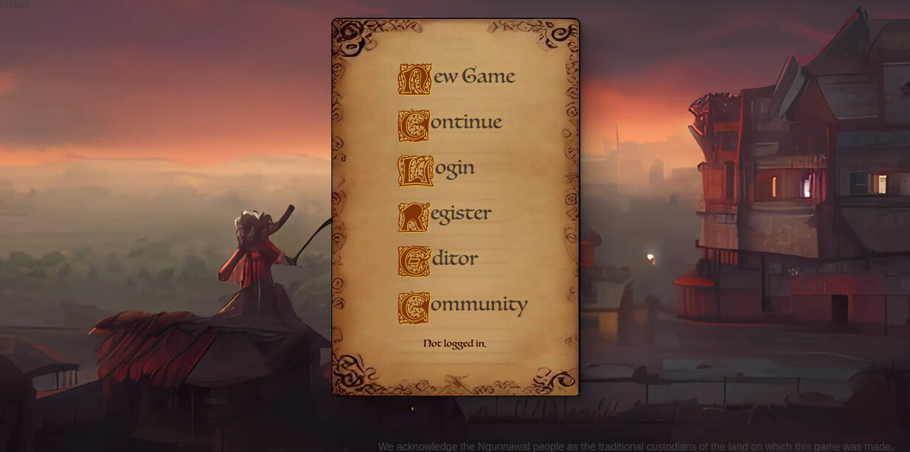
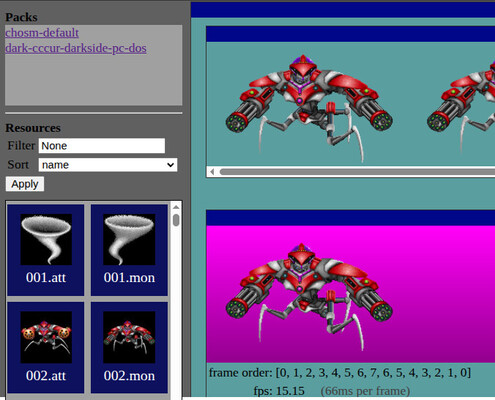
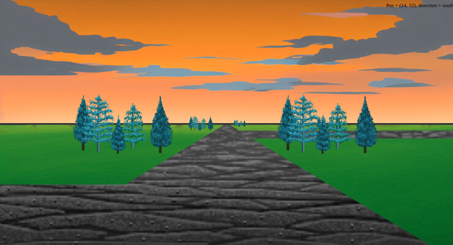

# CHOSM

> [!NOTE]
> I worked on this project in 2022 and got to about TRL 3.
> I learnt a few things I wanted to (mostly about web development etc) 
> and then decided the juice was not worth the squeeze going forward.
> So I am mothballing it. 

# Mothballing tasks performed:
  - adopt uv over pip
  - added a justfile
  - security audit
  - launch and fix any major issues

# Salvageable work:
  - Python port of the Xeen loaders:
    - See my other xeen repo [OpenXeen](https://github.com/busyDuckman/OpenXeen)
    - This hods a python adaption of the Xeen CC file loaders, which is a great leg up 
      for anyone wanting to work in that area.
  - The vanishing-point renderer in game_engine/single_vanishing_point_painting.py.
    It's the actual research idea behind the project, and is vier height and perspective 
    code advances on what was normal for the 80's/90's.
  - The dice notation parser in game_engine/dice.py is very handy
  - observable_dict.py and linkable_dict.py are useful little ADT's fro change notification
    and mergeable dictionaries. They also have unit tests.

## Screenshots

| Menu |
|:---:|
|  |

| Editor | Game |
|:---:|:---:|
|  |  |

# About 
This is an experimental project to explore what a modern version of a particular
type of game engine would look like. 

The type of engine was used in Might and Magic (MaM), Eye of the beholder (EoB), 
and Lands of Lore (LoL). It used a centered vanishing point to direct a sprite 
based painting algorith. The world view was presented above the portraits of a 
group of adventurers. 

I could find no industry term for this type of rendering, so I am calling it 
a "Centred Horizon Ordered Sprite Montage" (CHOSM).

This project aims to present its results in a web-browser based MMORPG.

For research into the rendering method, this project bootstraps itself from the data files
of the "Might and Magic" series of video games. **No game data is included in this repository.**
To run the server you need your own copy of Might and Magic: Darkside of Xeen; copy its
DARK.CC and DARK.CUR files into ./game_files/dos/

## Running the code

Requirements:
  - [uv](https://docs.astral.sh/uv/), which installs the right Python version and all packages.
  - [just](https://github.com/casey/just) (optional), a command runner for the tasks below.

Setup:

    just setup                # uv sync, then offers to create a test user account

Extracting data from cc files:

    # copy game files into ./game_files/dos/
    just bake

Running the web server:

    just serve                # uv run uvicorn web.chosm:app --reload

    # Landing page
    http://127.0.0.1:8000    

    # Editor is at
    http://127.0.0.1:8000/editor/main

    # API testing and doco
    http://127.0.0.1:8000/docs

Running the tests:

    just test

## Code doco

The code and software structure is documented, see: 

    docs/code_structure.md

## Concepts being explored
The scope of this project is ambitious, I believe this type of engine offers
some very interesting prospects; I am putting this vision into a separate file
and will add it here shortly.

## Disclaimer
The aim of this project is to investigate ideas, **not** recreate, or provide
access to the Might and Magic Games. If you wish to play these games, this can be
done via:
  - COG: https://www.gog.com/en/game/might_and_magic_6_limited_edition
  - Ebay: search for original media
  - Dosbox: https://www.dosbox.com/
  - ScummVM: https://wiki.scummvm.org/index.php/Might_and_Magic:_World_of_Xeen

## References & Acknowledgments:
  - Might and Magic reverse Engineering:
    - https://xeen.fandom.com/wiki/Xeen_Wiki
      - David Goldsmith
      - Mat Taylor
  - fastAPI (This was my first fast API proj, and I think it's awesome)
  - Cool parchment idea: https://codepen.io/AgnusDei/pen/NWPbOxL

